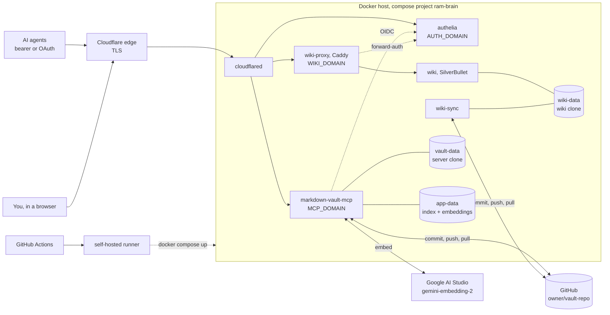

# ram — Random Agents Memories


One always-on **shared "second brain"** for AI agents on many machines, plus a **wiki in your
browser** for the human who owns it.

Agents read and write a git-backed markdown vault through a single
[`markdown-vault-mcp`](https://github.com/pvliesdonk/markdown-vault-mcp) server. Every write is
committed and pushed, and semantic search on Google's `gemini-embedding-2` finds a note from a
question asked in your own words, in Russian or English. You browse and edit the same notes in
[SilverBullet](https://silverbullet.md/), and your edits reach the agents' search within one
pull interval. Everything sits behind one Cloudflare Tunnel and one
[Authelia](https://www.authelia.com/) login.

| | |
| --- | --- |
| **MCP endpoint** | `https://<MCP_DOMAIN>/mcp`, streamable HTTP |
| **Auth** | multi-auth: a static bearer token (headless agents) **or** OAuth 2.1 / OIDC through Authelia (GUI clients) |
| **Wiki** | `https://<WIKI_DOMAIN>`: SilverBullet behind Authelia forward-auth |
| **Login portal** | `https://<AUTH_DOMAIN>`: Authelia, the users in `users_database.yml`, for both OAuth and the wiki |
| **Search** | semantic by default on `gemini-embedding-2` (Google AI Studio), with note title and heading context |
| **Vault** | a private GitHub repo `<owner>/<vault-repo>`, cloned and managed read-write by the server |
| **Ingress** | Cloudflare Tunnel, three hostnames, no published ports |
| **Deploy** | push to `main` → GitHub Actions → self-hosted runner → `docker compose` |

**Install your own:** [INSTALL.md](INSTALL.md).

## What's inside

| Service | What it does |
| --- | --- |
| `markdown-vault-mcp` | The MCP server: notes, links, conventions, semantic + keyword search, managed git (auto-commit, push, periodic rebase pull) |
| `authelia` | OIDC provider for MCP OAuth, and forward-auth for the wiki. Its user file is the allowlist |
| `cloudflared` | The tunnel: `<MCP_DOMAIN>` → MCP, `<AUTH_DOMAIN>` → Authelia, `<WIKI_DOMAIN>` → wiki-proxy |
| `wiki` | SilverBullet on its **own clone** of the vault |
| `wiki-sync` | Git for the wiki's clone: commits and pushes your edits, pulls the agents' |
| `wiki-proxy` | Caddy: asks Authelia about every wiki request |

### Search

- **Model:** `gemini-embedding-2` through Google AI Studio's OpenAI-compatible endpoint. Each
  section is embedded together with its note title and heading.
- **Chosen and tuned on the real vault** with [`bench/`](bench/): paraphrased Russian and
  English questions with known answers. The deployed search puts the right note first 98% of
  the time.
- **Semantic by default.** Keyword mode is there for exact identifiers: ticket numbers, file
  names.

### The wiki

- **Its own clone, synced through git** on the server's own timings: your edits are pushed
  `GIT_PUSH_DELAY_S` after you stop typing, agents' edits arrive every `GIT_PULL_INTERVAL_S`.
  The server reindexes what it pulls, so agents find your edits without a manual reindex.
- **One login** through Authelia, the same as for MCP OAuth.
- **Its settings live in this repo**, in `wiki/space/`: the page tree on the left, the fonts.
  They are copied in on every start, so change them here, not in the browser.

### What agents are told

- **The vault follows the [Open Knowledge Format](https://github.com/GoogleCloudPlatform/knowledge-catalog/blob/main/okf/SPEC.md) (OKF) v0.2**, an open
  format for knowledge bases written by and for agents. Every note has a `type` and a one-line
  `description`, `status` marks a note `draft`, `stable` or `deprecated`, and search ranks
  deprecated and stale notes lower. A copy of the spec is a note in the vault,
  `reference/okf/SPEC.md`, so agents can read it through MCP.
- **Authoring rules live in the vault**, in `_conventions.md` files: which `type` goes in which
  folder, frontmatter, tags, links, file names. Agents read them with `get_conventions`, and
  every write result repeats them.
- **MCP instructions** are the server's generated guidance plus two lines in `.env`:
  `INSTANCE_DESCRIPTION` (what this vault is) and `INSTRUCTIONS_EXTRA` (your rules, such as
  the language to write in, or offering to save lasting knowledge at the end of a task).

## Install

Step by step, from an empty GitHub account to connected agents: **[INSTALL.md](INSTALL.md)**.

## Deploying

`.github/workflows/deploy.yml` deploys on every push to `main` (put `[skip ci]` in the commit
message to skip) and refreshes the images weekly. The gitignored config files are rebuilt from
GitHub secrets on every run:

| Secret | Becomes |
| --- | --- |
| `DOTENV` | `.env` |
| `CLOUDFLARED_CONFIG` | `cloudflared/config.yml` |
| `AUTHELIA_CONFIG` | `authelia/configuration.yml` |
| `AUTHELIA_USERS` | `authelia/users_database.yml` |

**After a config change, update the secret and redeploy**
(`gh secret set <NAME> < <file>`). The runner reads the secret, not your local file.

## Connect

- **Claude Code and other headless agents**, with the bearer token:
  ```bash
  claude mcp add -t http -s user ram https://<MCP_DOMAIN>/mcp \
    -H "Authorization: Bearer <TOKEN>"
  ```
- **GUI clients** (Claude web and mobile, ChatGPT developer mode): add
  `https://<MCP_DOMAIN>/mcp` with OAuth and log in at `<AUTH_DOMAIN>`.
- **The wiki:** open `https://<WIKI_DOMAIN>`.

## Architecture



## Design rationale

- **One central server, one vault.** Every agent sees the others' writes at once, because they
  all go through the same server and index. Bearer and OAuth clients act as the same writer.
- **Multi-auth.** The bearer token is the simplest path for headless agents. OAuth sits beside
  it for GUI clients that expect a browser login. Authelia is the identity provider because it
  allows tokens of any lifetime, and MCP clients don't refresh reliably, so tokens last about
  a year.
- **One Authelia for everything.** The same login guards MCP OAuth and the wiki, so there is
  no second user system.
- **A remote embedding model.** Gemini ranks paraphrased Russian questions far better than the
  local models we tried, and re-embedding costs API calls instead of the host's CPU.
- **The wiki writes through git, never into the server's folder.** The server stays the only
  writer of its own working tree, and both sides already resolve conflicts on pull.
- **No published ports, no Cloudflare Access.** TLS ends at Cloudflare's edge; authentication
  belongs to the MCP server and Authelia.

### Considered and dropped

| Option | Why dropped |
| --- | --- |
| Cloudflare Access or Pocket ID as the IdP | token lifetimes capped at 1 month and 1 hour |
| Local fastembed models (bge-small, multilingual mpnet) | weaker on Russian paraphrases, and every re-embed pinned the host's CPU |
| Hybrid search as the default | its keyword half stems English only, so it misses Russian word forms |
| A static read-only site (Quartz) for browsing | the wiki needed editing too |
| Multiple vaults, per-agent branches | the server is single-tenant |
| SSH remotes / deploy keys | the server has no SSH auth path |
| GitHub push webhook | the periodic pull covers it for now; it is the first thing to enable if the wiki-to-agents delay starts to matter |

## License

Copyright 2026 Flopsstuff. Licensed under the [Apache License 2.0](LICENSE).
