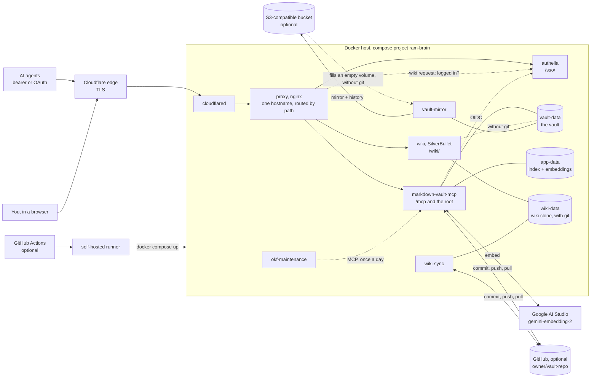

# ram — Random Agents Memories


One always-on **shared "second brain"** for AI agents on many machines, plus a **wiki in your
browser** for the human who owns it.

Agents read and write a markdown vault through a single
[`markdown-vault-mcp`](https://github.com/pvliesdonk/markdown-vault-mcp) server. The vault lives
on a docker volume. A git remote, where every write is committed and pushed, and a copy in an
S3-compatible bucket are both optional: see [Storage modes](#storage-modes). Semantic search on
Google's `gemini-embedding-2` finds a note from a question asked in your own words, in Russian
or English. You browse and edit the same notes in [SilverBullet](https://silverbullet.md/), and
your edits reach the agents' search within one pull interval with git, within seconds without
it. Everything sits on one hostname, behind one Cloudflare Tunnel and one
[Authelia](https://www.authelia.com/) login.

| | |
| --- | --- |
| **MCP endpoint** | `https://<DOMAIN>/mcp`, streamable HTTP |
| **Auth** | multi-auth: a static bearer token (headless agents) **or** OAuth 2.1 / OIDC through Authelia (GUI clients) |
| **Wiki** | `https://<DOMAIN>/wiki/`: SilverBullet behind the Authelia login |
| **Login portal** | `https://<DOMAIN>/sso/`: Authelia, the users in `users_database.yml`, for both OAuth and the wiki |
| **Search** | semantic by default on `gemini-embedding-2` (Google AI Studio), with note title and heading context |
| **Vault** | a docker volume. Optional: a private GitHub repo `<owner>/<vault-repo>`, cloned and managed read-write by the server, and a copy in an S3-compatible bucket |
| **Ingress** | Cloudflare Tunnel, one hostname routed by path, no published ports |
| **Run** | fill in the configuration once, then `docker compose up -d`. Optional: push to `main` → GitHub Actions → self-hosted runner |

**Install your own:** [INSTALL.md](INSTALL.md).

## What's inside

| Service | What it does |
| --- | --- |
| `markdown-vault-mcp` | The MCP server: notes, links, conventions, semantic + keyword search. With git: managed git (auto-commit, push, periodic rebase pull). Without: a file watcher that indexes what the wiki writes |
| `authelia` | OIDC provider for MCP OAuth, and the login in front of the wiki. Its user file is the allowlist |
| `cloudflared` | The tunnel: hands every request for `<DOMAIN>` to `proxy` |
| `proxy` | nginx: routes the one hostname by path (see [One hostname](#one-hostname)) and asks Authelia about every wiki request |
| `wiki` | SilverBullet. With git: on its **own clone** of the vault. Without: on the server's volume |
| `wiki-sync` | Prepares the wiki's folder. With git: commits and pushes your edits, pulls the agents'. Without: copies the wiki settings in and idles |
| `vault-mirror` | rclone: mirrors the vault to an S3-compatible bucket and keeps replaced and deleted files as history. Idles when no bucket is set |
| `okf-maintenance` | Once a day: turns wikilinks left by the wiki into OKF links, regenerates every folder's `index.md`, and reports notes that break the format and links that lead nowhere |

### One hostname

Everything is served from `<DOMAIN>`. The `proxy` service (nginx, `proxy/nginx.conf`) is the
only thing the tunnel talks to, and the path decides where a request goes:

| Path | Goes to | Login |
| --- | --- | --- |
| `/mcp`, the OAuth endpoints (`/authorize`, `/token`, `/register`, `/auth/callback`), `/.well-known/...`, upload and download links, and everything else at the root | the MCP server | bearer token or OAuth |
| `/wiki/` | SilverBullet | the Authelia session; nginx asks Authelia about every request |
| `/sso/` | Authelia: the login portal and the OIDC provider | none: this is where you log in |
| exactly `/` | a redirect to `/wiki/` | none |

The MCP server keeps the root because MCP clients look for the OAuth metadata at the root of
the host. A new app gets its own prefix in `proxy/nginx.conf`.

### Storage modes

The `vault-data` docker volume is always there. A git remote and a bucket are independent,
optional add-ons, both chosen in `.env`:

| Mode | `.env` | Wiki works on | An empty volume is filled from |
| --- | --- | --- | --- |
| Volume only | no `GIT_*`, no `BUCKET_*`, `WIKI_VOLUME=vault-data` | the server's `vault-data` volume | nothing: it starts empty |
| Git | the Git block, `WIKI_VOLUME` unset | its own clone on `wiki-data` | `git clone` |
| Bucket | `BUCKET_*`, `WIKI_VOLUME=vault-data` | the server's `vault-data` volume | the bucket |
| Git + bucket | both blocks, `WIKI_VOLUME` unset | its own clone on `wiki-data` | `git clone`; the bucket is a second copy, never restored from |

- **Git** gives full history (`get_history`, `get_diff`), an off-host copy, and a merge when an
  agent and the browser edit the same note.
- **Without git** the wiki writes straight into the server's folder and the server's file
  watcher indexes the change, so a browser edit is searchable about two seconds later. There is
  no history and no merge: when an agent and the browser write the same file at once, the last
  write wins.
- **The bucket** is a backup with automatic restore, not a second place to edit. Every
  `BUCKET_SYNC_INTERVAL_S` (300 by default) the vault is mirrored one way to `<prefix>/vault`.
  A file that a pass replaces or deletes moves to `<prefix>/history/<UTC time>/` and stays
  there for `BUCKET_HISTORY_DAYS` (30 by default, `0` keeps it forever). Without git, a new
  or wiped volume is filled from the bucket at start. An object changed in the bucket does not reach a
  running server. Works with Google Cloud Storage, DigitalOcean Spaces, AWS S3, Cloudflare R2
  and MinIO.
- **`WIKI_VOLUME` must match the git setting.** `wiki-sync` refuses to start on a wrong
  pairing and says so in its log.

### Search

- **Model:** `gemini-embedding-2` through Google AI Studio's OpenAI-compatible endpoint. Each
  section is embedded together with its note title and heading.
- **Chosen and tuned on the real vault** with [`bench/`](bench/): paraphrased Russian and
  English questions with known answers. The deployed search puts the right note first 98% of
  the time.
- **Semantic by default.** Keyword mode is there for exact identifiers: ticket numbers, file
  names.

### The wiki

- **With git: its own clone, synced through git** on the server's own timings: your edits are
  pushed `GIT_PUSH_DELAY_S` after you stop typing, agents' edits arrive every
  `GIT_PULL_INTERVAL_S`. The server reindexes what it pulls, so agents find your edits without
  a manual reindex.
- **Without git: the server's own folder.** The wiki and the server share the `vault-data`
  volume and run as the same user. There is no sync step: the wiki reads the files agents write,
  and the server's file watcher indexes your edit within seconds.
- **Reserved names.** SilverBullet keeps its own files at the vault root: `CONFIG.md`,
  `Library/`, `_plug/`, `.silverbullet*`. `MARKDOWN_VAULT_MCP_EXCLUDE` keeps them out of the index, so
  agents do not find them in search or listings (reading one by its exact path still works), and with git they never reach the vault repo. Do not give a note one of these
  names: it would not be indexed. Without git this exclusion is all that separates the wiki's
  files from the notes.
- **One login** through Authelia, the same as for MCP OAuth.
- **Its settings live in this repo**, in `wiki/space/`: the page tree on the left, the fonts.
  They are copied in on every start, so change them here, not in the browser.

### What agents are told

- **The vault follows the [Open Knowledge Format](https://github.com/GoogleCloudPlatform/knowledge-catalog/blob/main/okf/SPEC.md) (OKF) v0.2**, an open
  format for knowledge bases written by and for agents. Every note has a `type` and a one-line
  `description`, `status` marks a note `draft`, `stable` or `deprecated`, and search ranks
  deprecated and stale notes lower. A copy of the spec is a note in the vault,
  `reference/okf/SPEC.md`, so agents can read it through MCP.
- **Authoring rules live in the vault**, in `_conventions.md` files: which `type` goes in which
  folder, frontmatter, tags, links, file names. Agents read them with `get_conventions`, and
  every write result repeats them.
- **MCP instructions** are the server's generated guidance plus two lines in `.env`:
  `INSTANCE_DESCRIPTION` (what this vault is) and `INSTRUCTIONS_EXTRA` (your rules, such as
  the language to write in, or offering to save lasting knowledge at the end of a task).

## Install

Step by step, from an empty host to connected agents: **[INSTALL.md](INSTALL.md)**.

## Running

The whole service is one docker compose stack. Fill in the three configuration files once
(`.env`, `authelia/configuration.yml`, `authelia/users_database.yml`, each from its `*.example`
template) and start it on any host with Docker:

```bash
docker compose up -d
```

Everything the service does on a schedule runs inside the stack: git sync, the bucket mirror,
and the daily OKF upkeep, whose report is in `docker compose logs okf-maintenance`. Updating
the images is the one thing left to you: `docker compose pull`, then `docker compose up -d`.

### Deploying from GitHub Actions (optional)

`.github/workflows/deploy.yml` runs that same compose stack from a self-hosted runner: on every
push to `main` (put `[skip ci]` in the commit message to skip) and once a week to refresh the
images. The gitignored config files are rebuilt from GitHub secrets on every run:

| Secret | Becomes |
| --- | --- |
| `DOTENV` | `.env` |
| `AUTHELIA_CONFIG` | `authelia/configuration.yml` |
| `AUTHELIA_USERS` | `authelia/users_database.yml` |

**After a config change, update the secret and redeploy**
(`gh secret set <NAME> < <file>`). The runner reads the secret, not your local file.

## Connect

- **Claude Code and other headless agents**, with the bearer token:
  ```bash
  claude mcp add -t http -s user ram https://<DOMAIN>/mcp \
    -H "Authorization: Bearer <TOKEN>"
  ```
- **GUI clients** (Claude web and mobile, ChatGPT developer mode): add
  `https://<DOMAIN>/mcp` with OAuth and log in at the Authelia portal the client opens
  (`https://<DOMAIN>/sso/`).
- **The wiki:** open `https://<DOMAIN>/wiki/`, or just `https://<DOMAIN>`, which redirects
  there.

## Architecture



## Design rationale

- **One central server, one vault.** Every agent sees the others' writes at once, because they
  all go through the same server and index. Bearer and OAuth clients act as the same writer.
- **Multi-auth.** The bearer token is the simplest path for headless agents. OAuth sits beside
  it for GUI clients that expect a browser login. Authelia is the identity provider because it
  allows tokens of any lifetime, and MCP clients don't refresh reliably, so tokens last about
  a year.
- **One Authelia for everything.** The same login guards MCP OAuth and the wiki, so there is
  no second user system.
- **One hostname, routed by path.** One nginx behind the tunnel sends `/wiki/` to the wiki,
  `/sso/` to Authelia and everything else to the MCP server. An install needs one name, one DNS
  record and three configuration files. The MCP server keeps the root because MCP clients look
  for the OAuth metadata at the root of the host; every other app lives under its own prefix.
- **The price of one hostname is one browser origin.** The wiki, the login portal and the MCP
  OAuth endpoints share it. SilverBullet runs scripts found in notes, and notes are written by
  agents, so a script in a note can reach `/sso/` and the OAuth endpoints with the reader's
  session. Separate hostnames used to prevent that. The simpler install was chosen anyway: the
  wiki is a review tool for the owner, and agents are told to treat notes as data.
- **A remote embedding model.** Gemini ranks paraphrased Russian questions far better than the
  local models we tried, and re-embedding costs API calls instead of the host's CPU.
- **With git, the wiki writes through git, never into the server's folder.** The server stays
  the only writer of its own working tree, and both sides already resolve conflicts on pull. A
  second writer there would leave uncommitted files that block the server's rebase and never
  reach its index.
- **Without git, the wiki writes into the server's folder.** There is no rebase to block, and
  the server's file watcher, which is on whenever git is off, indexes the change. A second copy
  of the vault would have nothing to sync it.
- **The volume is the vault; git and the bucket are add-ons.** Each can be turned on alone, and
  an instance with neither still works.
- **The bucket is a one-way mirror with history, not two-way sync.** One host writes the vault,
  so nothing needs to come back from the bucket except a restore onto a new or wiped volume. Two-way
  sync is fragile: it needs its own state on both sides and a rule for every conflict. A plain
  mirror with the replaced and deleted files kept aside covers the same loss cases. The mirror
  marks the volume it has seen: a wiped or swapped volume carries no mark and is never mirrored
  over the copy, while a vault you emptied yourself is mirrored like any other change.
- **No published ports, no Cloudflare Access.** TLS ends at Cloudflare's edge; authentication
  belongs to the MCP server and Authelia.

### Considered and dropped

| Option | Why dropped |
| --- | --- |
| Cloudflare Access or Pocket ID as the IdP | token lifetimes capped at 1 month and 1 hour |
| Three hostnames (MCP, login, wiki), split by a tunnel ingress file, with Caddy in front of the wiki | it kept the wiki on its own browser origin, but an install needed three DNS records under one parent domain and a fourth configuration file |
| Local fastembed models (bge-small, multilingual mpnet) | weaker on Russian paraphrases, and every re-embed pinned the host's CPU |
| Hybrid search as the default | its keyword half stems English only, so it misses Russian word forms |
| A static read-only site (Quartz) for browsing | the wiki needed editing too |
| Multiple vaults, per-agent branches | the server is single-tenant |
| SSH remotes / deploy keys | the server has no SSH auth path |
| GitHub push webhook | the periodic pull covers it for now; it is the first thing to enable if the wiki-to-agents delay starts to matter |

## License

Copyright 2026 Flopsstuff. Licensed under the [Apache License 2.0](LICENSE).
