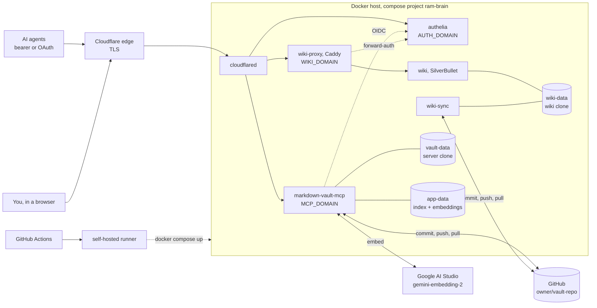

# ram — Random Agents Memories


One always-on **shared "second brain"** for AI agents on many machines, plus a **wiki in your
browser** for the human who owns it.

Agents read and write a git-backed markdown vault through a single
[`markdown-vault-mcp`](https://github.com/pvliesdonk/markdown-vault-mcp) server. Every write is
committed and pushed, and semantic search on Google's `gemini-embedding-2` finds a note from a
question asked in your own words, in Russian or English. You browse and edit the same notes in
[SilverBullet](https://silverbullet.md/), and your edits reach the agents' search within one
pull interval. Everything sits behind one Cloudflare Tunnel and one
[Authelia](https://www.authelia.com/) login.

| | |
| --- | --- |
| **MCP endpoint** | `https://<MCP_DOMAIN>/mcp`, streamable HTTP |
| **Auth** | multi-auth: a static bearer token (headless agents) **or** OAuth 2.1 / OIDC through Authelia (GUI clients) |
| **Wiki** | `https://<WIKI_DOMAIN>`: SilverBullet behind Authelia forward-auth |
| **Login portal** | `https://<AUTH_DOMAIN>`: Authelia, one user, for both OAuth and the wiki |
| **Search** | semantic by default on `gemini-embedding-2` (Google AI Studio), with note title and heading context |
| **Vault** | a private GitHub repo `<owner>/<vault-repo>`, cloned and managed read-write by the server |
| **Ingress** | Cloudflare Tunnel, three hostnames, no published ports |
| **Deploy** | push to `main` → GitHub Actions → self-hosted runner → `docker compose` |

## What's inside

| Service | What it does |
| --- | --- |
| `markdown-vault-mcp` | The MCP server: notes, links, conventions, semantic + keyword search, managed git (auto-commit, push, periodic rebase pull) |
| `authelia` | OIDC provider for MCP OAuth, and forward-auth for the wiki. Its single user is the allowlist |
| `cloudflared` | The tunnel: `<MCP_DOMAIN>` → MCP, `<AUTH_DOMAIN>` → Authelia, `<WIKI_DOMAIN>` → wiki-proxy |
| `wiki` | SilverBullet on its **own clone** of the vault, pinned to `2.12.1-slim` |
| `wiki-sync` | Git for the wiki's clone: commits and pushes your edits, pulls the agents' |
| `wiki-proxy` | Caddy: asks Authelia about every wiki request, serves the wiki's favicon |

### Search: Gemini embeddings, semantic first

- **Model:** `gemini-embedding-2` (3072 dimensions) through Google AI Studio's
  OpenAI-compatible endpoint (`EMBEDDING_PROVIDER=openai`, `OPENAI_BASE_URL`, key in
  `OPENAI_API_KEY`). `EMBED_CONTEXT=true` embeds each chunk with its note title and heading.
- **Chosen with [`bench/`](bench/)** against OpenRouter and local models on the real vault, with
  paraphrased Russian and English questions whose answers are known.
- **Tuned on the live server:**
  - `LENGTH_DOWNWEIGHT_ALPHA=0.01`: with Gemini's narrow score band, the upstream 0.25 pushed
    one-chunk notes above the right answer (top-1 16%). At 0.01 the deployed search finds the
    right note first 98% of the time (MRR ≈ 0.99).
  - `DEFAULT_SEARCH_MODE=semantic`: hybrid mixes in SQLite FTS5, whose English stemmer misses
    Russian word forms. Hybrid put the right note first only 12% of the time. Keyword mode stays
    available for exact identifiers.
- **Startup patch:** Gemini's endpoint omits `index` on the first embedding of a batch, which
  breaks the server's sort. `patches/sitecustomize.py` fills it in until the upstream fix ships
  in a release.
- Changing the model, the provider or `EMBED_CONTEXT` re-embeds the whole vault on the next
  start.

### The wiki

- **Own clone, synced through git.** `wiki-sync` uses the MCP server's own git settings from
  `.env`:
  - it commits and pushes `GIT_PUSH_DELAY_S` after your last keystroke (one commit per pause,
    author `<GIT_COMMIT_NAME> (wiki)`);
  - it pulls every `GIT_PULL_INTERVAL_S`;
  - on a same-line conflict your edit wins (`rebase -X theirs`), and the agent's other changes in
    the file are kept.
- **Agents see your edits without a reindex.** The server picks them up on its next pull and
  reindexes the changed notes itself.
- **Settings live in this repo, `wiki/space/`.** `wiki-sync` copies them in on every start:
  - the page tree opens on the left;
  - text uses the system sans-serif font, and code stays monospace;
  - the settings pages are hidden from the tree.

  Change them here, not in the browser: the next deploy overwrites browser-side settings.
- **Nothing of SilverBullet's reaches the vault.** Its files (`CONFIG.md`, `Library/`, `_plug/`)
  are in the clone's `.git/info/exclude`.
- **Login.** `wiki-proxy` sends everything through Authelia, except two static paths: the
  favicon set (`wiki/icons/`) and SilverBullet's `/service_worker.js`. Browsers refuse a
  service-worker script that redirects to a login page.
- **Pinned to `2.12.1-slim`.** SilverBullet 3.0 moves `CONFIG.md` to `Library/Config.md` and
  runs `space-lua` only from `Library/`, so upgrade by hand.

### What agents are told

- **Authoring rules live in the vault**, in `_conventions.md` files. They cover folders,
  required frontmatter, tags, wikilinks and file names, and they accumulate root-first.
  Agents read them with `get_conventions`, and every write result carries them.
- **MCP instructions** are the server's generated guidance plus two `.env` lines:
  `INSTANCE_DESCRIPTION` (what this vault is) and `INSTRUCTIONS_EXTRA`. The extra line tells
  agents to:
  - write in Russian;
  - read the conventions before writing;
  - leave `mode` unset (semantic) and use `keyword` for exact identifiers;
  - **offer, at the end of a task, to save lasting knowledge to ram, and write it only after
    the user agrees.**
- **`OKF_MODE=off`.** The vault is not an OKF bundle. Left on auto, the server told agents to
  maintain `log.md`/`index.md` and to use relative Markdown links, against the conventions.
  The extra text also pushed the instructions past Claude Code's 2,048-character cap.
- **This repo is public**, so nothing vault-specific lives in it: no note names, folders or
  instruction text.

## Files

| File | Purpose | In git? |
| --- | --- | --- |
| `docker-compose.yml` | the six services, their volumes and the `brain` network | ✅ |
| `.env.example` / `.env` | env template / **real secrets** (bearer, OIDC, git PAT, Gemini key, tunnel) | ✅ / 🚫 |
| `cloudflared/config.yml.example` / `.yml` | tunnel ingress template / **real** (tunnel ID + hostnames) | ✅ / 🚫 |
| `authelia/configuration.yml.example` / `.yml` | Authelia (OIDC + forward-auth) template / **real** (secrets, JWKS, client) | ✅ / 🚫 |
| `authelia/users_database.yml.example` / `.yml` | allowlist template / **real** (user + password hash) | ✅ / 🚫 |
| `patches/sitecustomize.py` | startup patch: fills the embedding `index` Gemini omits (until the upstream fix ships) | ✅ |
| `wiki/sync.sh` | git sync of the wiki's clone | ✅ |
| `wiki/Caddyfile` | wiki-proxy: Authelia forward-auth, public icon and service-worker paths | ✅ |
| `wiki/space/` | wiki settings (`CONFIG.md`) and style (`Library/wiki-style.md`), copied in on start | ✅ |
| `wiki/icons/` | the wiki's favicon set | ✅ |
| `bench/` | embedding-model comparison harness; corpus, queries and keys stay in gitignored `bench/.data/` and `bench/.env` | ✅ (code only) |
| `.github/workflows/deploy.yml` | CD to the self-hosted runner | ✅ |

## First-time setup

1. **Server secrets.** Copy `.env.example` → `.env` and fill:
   - `MARKDOWN_VAULT_MCP_BEARER_TOKEN` (`openssl rand -hex 32`);
   - `MARKDOWN_VAULT_MCP_GIT_TOKEN`: a GitHub fine-grained PAT, *Contents: Read and write* on the
     vault repo, owned by the account that owns that repo;
   - `OPENAI_API_KEY`: a Google AI Studio key (bare name, no prefix);
   - the `MARKDOWN_VAULT_MCP_OIDC_*` block: client secret (plaintext, see step 2) and a
     **stable** `openssl rand -hex 32` signing key. Leave `AUTH_MODE` unset: auto-detect enables
     multi-auth when both bearer and OIDC are present.

2. **Authelia.** Copy both `.example` files under `authelia/` to their real names and fill
   in the secrets:
   ```bash
   IMG=authelia/authelia:latest
   # JWKS private key → paste into configuration.yml (identity_providers.oidc.jwks[].key)
   docker run --rm --entrypoint authelia -u "$(id -u):$(id -g)" -v "$PWD/authelia":/keys $IMG \
     crypto pair rsa generate --directory /keys
   # client secret: plaintext → .env (OIDC_CLIENT_SECRET), $pbkdf2$ hash → configuration.yml
   docker run --rm --entrypoint authelia $IMG \
     crypto hash generate pbkdf2 --variant sha512 --random --random.length 72
   # login password hash → users_database.yml
   docker run --rm --entrypoint authelia $IMG crypto hash generate argon2 --password '<login-password>'
   # hmac / session / storage / jwt secrets (run once each) → configuration.yml
   docker run --rm --entrypoint authelia $IMG crypto rand --length 64 --charset alphanumeric
   ```
   Validate before deploying:
   ```bash
   docker run --rm --entrypoint authelia -v "$PWD/authelia":/config $IMG \
     validate-config --config /config/configuration.yml
   ```
   The single user in `users_database.yml` **is** the allowlist. The session cookie goes on
   the parent domain of `<AUTH_DOMAIN>`, so the wiki host must sit under it too.

3. **Cloudflare Tunnel** (once, on a machine with a browser):
   ```bash
   cloudflared tunnel login
   cloudflared tunnel create my-tunnel                    # prints TUNNEL_ID + creds json path
   cloudflared tunnel route dns my-tunnel <MCP_DOMAIN>    # all three hosts point at
   cloudflared tunnel route dns my-tunnel <AUTH_DOMAIN>   # the same tunnel
   cloudflared tunnel route dns my-tunnel <WIKI_DOMAIN>
   ```
   Copy `cloudflared/config.yml.example` → `cloudflared/config.yml`, set the tunnel ID and the
   real hostnames, then put into `.env`:
   - `CF_TUNNEL_ID` = the printed tunnel UUID;
   - `TUNNEL_CRED_CONTENTS` = the creds JSON on one line.

   **Do NOT** put Cloudflare Access on any of these hostnames. It breaks the bearer header for
   headless agents and injects its own auth in front of both Authelia flows.

4. **Bring up:**
   ```bash
   docker compose up -d
   docker compose logs -f markdown-vault-mcp   # clone, index build, embeddings
   docker compose logs -f wiki-sync            # the wiki's clone
   ```

### Deploying via CI (self-hosted runner)

`.github/workflows/deploy.yml` deploys on every push to `main` (put `[skip ci]` in the
commit message to skip). It also runs a weekly image refresh. `actions/checkout` runs
`git clean`, which wipes the gitignored files, so every run **materializes** them from GitHub
secrets:

| Secret | Materializes |
| --- | --- |
| `DOTENV` | `.env` |
| `CLOUDFLARED_CONFIG` | `cloudflared/config.yml` |
| `AUTHELIA_CONFIG` | `authelia/configuration.yml` |
| `AUTHELIA_USERS` | `authelia/users_database.yml` |

Set them with `gh secret set <NAME> < <file>`. **After a config change, update the secret and
redeploy.** The runner reads the secret, not your local file.

`docker compose up -d` does not recreate a container when only a bind-mounted file's contents
change. The deploy therefore force-recreates every service that reads one: `authelia`,
`cloudflared`, `markdown-vault-mcp` (the patch), `wiki-proxy` and `wiki-sync`. On the host by
hand, use `docker compose up -d --force-recreate <service>`.

Named volumes survive the `git clean`:
- `vault-data`: the server's clone;
- `app-data`: index, embeddings, sessions;
- `authelia-data`: Authelia's SQLite;
- `wiki-data`: the wiki's clone and its settings.

## Connect and verify

```bash
curl -i https://<MCP_DOMAIN>/mcp                                    # 401 + WWW-Authenticate
curl -i https://<MCP_DOMAIN>/mcp -H "Authorization: Bearer <TOKEN>" # an MCP response
curl -s -o /dev/null -w '%{http_code}\n' https://<AUTH_DOMAIN>/.well-known/openid-configuration       # 200
curl -s -o /dev/null -w '%{http_code}\n' https://<MCP_DOMAIN>/.well-known/oauth-authorization-server # 200
curl -s -o /dev/null -w '%{http_code} %{redirect_url}\n' https://<WIKI_DOMAIN>/  # 302 → the Authelia portal
```

- **Headless agent** (Claude Code) with the bearer:
  ```bash
  claude mcp add -t http -s user ram https://<MCP_DOMAIN>/mcp \
    -H "Authorization: Bearer <TOKEN>"
  ```
- **GUI client** (ChatGPT Developer mode, Claude web/mobile): add `https://<MCP_DOMAIN>/mcp` with
  Auth = **OAuth**.
  - The client performs DCR + PKCE, and you log in at `<AUTH_DOMAIN>`.
  - Tokens last ~1 year, because MCP clients don't refresh reliably.
- **Wiki:** open `https://<WIKI_DOMAIN>` and log in once; the same session covers the portal.

### OAuth troubleshooting

Both fixes go in the OIDC client in `authelia/configuration.yml`:

- **`invalid_target` at the login redirect.** MCP clients send `resource=https://<MCP_DOMAIN>/mcp`
  (RFC 8707). Fix: add `https://<MCP_DOMAIN>` and `https://<MCP_DOMAIN>/mcp` to the client's
  `audience`.
- **`invalid_client` at token exchange.** FastMCP authenticates with HTTP Basic. Fix: set
  `token_endpoint_auth_method: 'client_secret_basic'`.

## Operating notes

- **Edit through the server, the wiki or a git push, never in the server's `/vault`.**
  - The server pulls every `GIT_PULL_INTERVAL_S` with a rebase. On a conflicting file it keeps
    the remote version and saves its own as a separate conflict file.
  - After every pull it reindexes what changed.
  - Writing straight into its working tree is the one thing that breaks: uncommitted files block
    the rebase and never reach the index.
  - A GitHub push webhook (`POST /github-webhook`, `MARKDOWN_VAULT_MCP_GITHUB_WEBHOOK_SECRET`)
    would make pushes land at once. It is not enabled.
- **Concurrent agents** share one git identity. Separation is by folder convention, not
  enforced by the server.
- **Rotating credentials:**

  | Rotate | Effect |
  | --- | --- |
  | `BEARER_TOKEN` | logs out bearer agents |
  | `GIT_TOKEN` | stops sync for the server and the wiki until `.env` is updated |
  | `OIDC_JWT_SIGNING_KEY` | the **OAuth kill switch**: every OAuth token dies at once |
  | the Authelia password | blocks new logins |
- **Boot-time re-embedding.** A note written through the server is only recorded in the
  server's change snapshot by a full reindex, so a restart re-embeds the notes written since
  the last one. With Gemini that costs API calls, not CPU. The `cpus` cap stays as a guard in
  case embeddings move back to a local model.

### Note-linking convention (wikilinks)

- **Link to a real vault path without the extension:** `[[projects/<project>/overview]]`,
  `[[machines/<host>]]`.
  - A bare `[[basename]]` only resolves for a file at the vault root.
  - Never link to an agent's local memory slug.
  - Audit with `get_outlinks` / `get_broken_links`.
- **`[[...]]` is not clickable on GitHub.** It is mcp-md / Obsidian / SilverBullet syntax, not
  standard Markdown. In the wiki these links work as normal links.

## Architecture



## Design rationale

- **One central server, one shared identity.** One instance, one vault, one working tree, so
  every agent sees the others' writes right away. Bearer and OAuth clients map to the same
  single-tenant vault.
- **Multi-auth.** The bearer is the simplest auth for headless clients, and it stays. OAuth was
  added alongside it for GUI clients that expect a browser login.
  - **Authelia** is the IdP because it allows **arbitrary token lifespans**. Tokens last ~1 year,
    because MCP clients don't refresh.
  - The `id_token` lifetime must match the `access_token`: its `exp` gates the session.
- **The same Authelia guards the wiki**, through forward-auth. There is one user and one login,
  and no second identity system.
- **Gemini embeddings over local models.** The bench showed the remote model ranks paraphrased
  Russian questions far better. A model switch costs API calls instead of minutes of
  saturated CPU on the host.
- **Semantic by default, keyword on request.** FTS5's English stemmer is the weak half of
  hybrid on a Russian vault.
- **Three hostnames, one tunnel, ingress in `config.yml`.** The real hostnames and the tunnel
  ID stay out of git: the file is gitignored and materialized from a secret.
- **The wiki gets its own clone, not a share of `/vault`.** Going through git keeps the server
  the only writer of its tree, and both sides already resolve conflicts on pull.
- **HTTPS git remote, PAT owned by the repo owner.** SSH remotes are rejected when a token is
  set. A fine-grained PAT reaches only repos its own account owns.
- **`/data` is separate from `/vault`**, so the index, embeddings and sessions never reach git.
- **The overridden `entrypoint:` on `markdown-vault-mcp` is load-bearing.** Named volumes mount
  root-owned, and the image fixes only `/data`. The wrapper `chown`s a fresh `/vault`, then
  `exec`s the stock entrypoint.
- **No published ports, never Cloudflare Access.** TLS ends at the edge, and auth belongs to the
  MCP server and Authelia.
- **Streamable HTTP, not SSE.** The tunnel proxies it cleanly.

### Considered and dropped

| Option | Why dropped |
| --- | --- |
| Cloudflare Access or Pocket ID as the IdP | token lifetimes capped at 1 month and 1 hour |
| Local fastembed models (bge-small, multilingual mpnet) | weaker on Russian paraphrases, and every re-embed pinned the host's CPU |
| Hybrid search as the default | FTS5 stemming is English-only |
| A static read-only site (Quartz) for browsing | the wiki needed editing too |
| Multiple vaults, per-agent branches | the server is single-tenant |
| SSH remotes / deploy keys | no SSH auth path |
| GitHub push webhook | the periodic pull covers it for now; it is the first thing to enable if the wiki-to-agents delay starts to matter |

## License

Copyright 2026 Flopsstuff. Licensed under the [Apache License 2.0](LICENSE).
